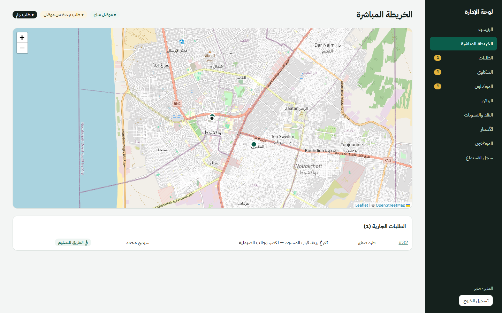
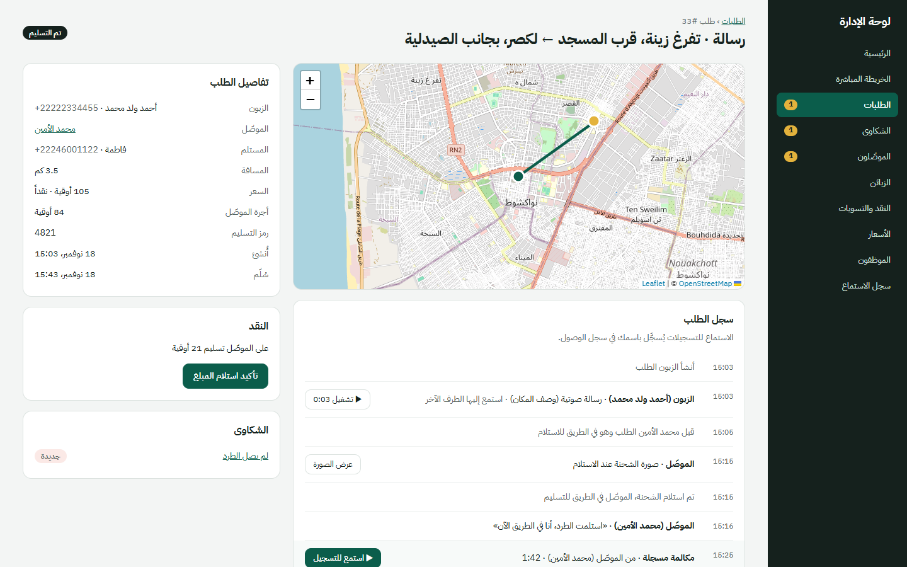
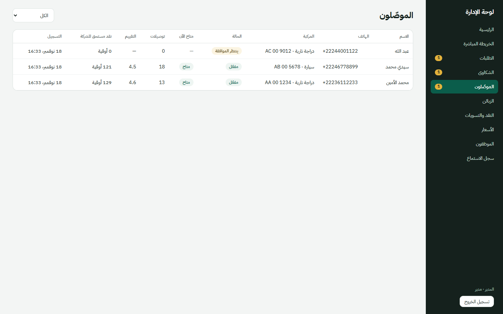
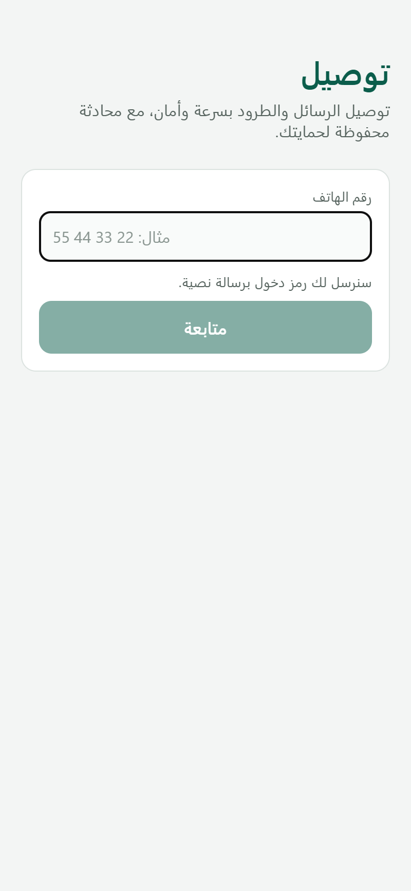
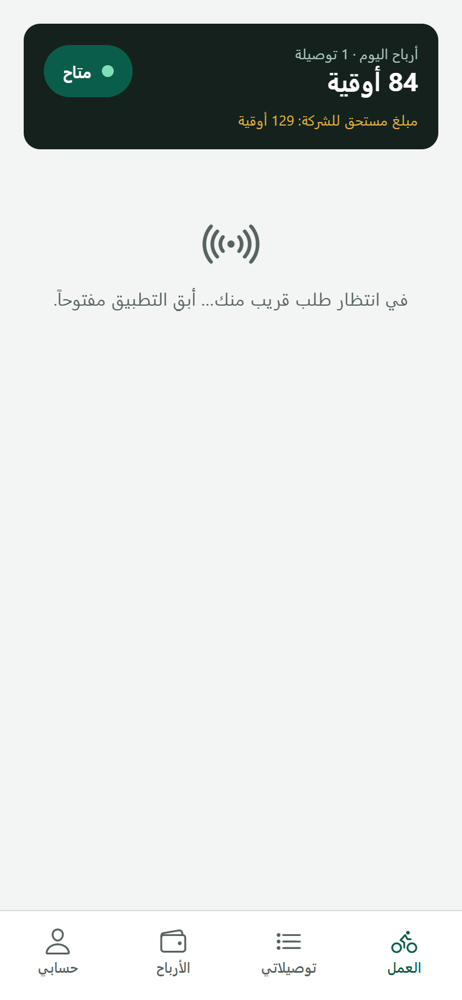
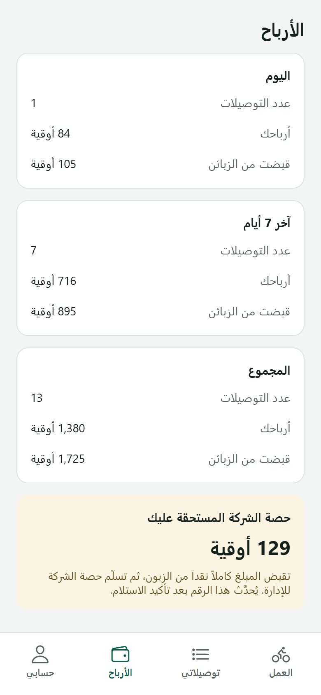

# Tawsil — Delivery App for Mauritania

A complete letter and parcel delivery system made up of three parts:

| Folder | What it is | Technology |
| --- | --- | --- |
| `server/` | Backend and database | Node.js + Express + Socket.io + SQLite |
| `admin/` | Admin dashboard (website) | Next.js |
| `mobile/` | Phone app for customers and couriers (one app, users choose their account type at sign-up) | React Native (Expo) |

## Features

**Customer:** sign-in with phone number and SMS code · pickup and drop-off selection on the map · voice description of the location · shipment type · price shown before ordering · cash payment · live tracking · delivery code sent to the recipient by message · text and voice chat · recorded calls · cancellation · rating · complaints.

**Courier:** document upload and approval flow · available/unavailable toggle · orders offered to the nearest courier with a 30-second timeout · accept or decline · listen to the customer's voice description · open the route in Google Maps · photograph the shipment at pickup · confirm delivery with the recipient's code · earnings and amount owed to the company.

**Admin:** daily indicators and chart · live map · orders and their details · **complaint file**: all messages, recordings, photos and the courier's route in chronological order, with a decision and a note sent to both parties · courier approval and suspension · customers · cash settlement · pricing and commission · staff with three roles (admin, support, accountant) · **listening log**: who opened each recording and when.

**Privacy:** phone numbers are hidden between customer and courier · audio files open only through temporary links (10 minutes) · accountants cannot listen to recordings · recordings are deleted automatically 60 days after the order closes (or after the complaint decision), and nothing is deleted while a complaint is open.

---

## Screenshots

> The interface is in Arabic. All names and numbers shown are demo data from `npm run seed`. The mobile screenshots were taken from a web build at phone size, using OpenStreetMap instead of the native maps, so the app may look slightly different on a device.

### Admin dashboard

| Home | Live map |
| --- | --- |
|  |  |

| Orders | Order details |
| --- | --- |
|  |  |

| Complaint file | Couriers |
| --- | --- |
|  |  |

| Cash and settlements | Pricing |
| --- | --- |
|  |  |

| Staff | Sign-in |
| --- | --- |
|  |  |

### Customer app

| Sign-in | New order | Live tracking | Chat | My orders |
| --- | --- | --- | --- | --- |
|  |  |  |  |  |

### Courier app

| Work | My deliveries | Earnings |
| --- | --- | --- |
|  |  |  |

---

## Running in VS Code

### 1. One-time requirements

- **Node.js 20 or later** from [nodejs.org](https://nodejs.org) (choose LTS).
- **VS Code**.
- On your phone: the **Expo Go** app from Google Play or the App Store.
- Your computer and phone on the **same Wi-Fi network**.

Open the whole `tawsil` folder in VS Code (File › Open Folder). You will need three terminals (Terminal › New Terminal, then the `+` button to open another one).

### 2. Server (first terminal)

```bash
cd server
npm install
copy .env.example .env      # On Mac/Linux: cp .env.example .env
npm run seed                # Optional: demo data (customers, couriers, orders, a complaint)
npm start
```

You should see `يعمل على http://localhost:4000` ("running on http://localhost:4000").
During testing, the sign-in code (OTP) appears in this terminal and inside the app.

To check that everything works: `npm test` (runs a complete order cycle automatically, 16 tests).

### 3. Admin dashboard (second terminal)

```bash
cd admin
npm install
copy .env.example .env.local
npm run dev
```

Open [http://localhost:3000](http://localhost:3000) and sign in with `admin` / `admin123` (change these in `server/.env` before deploying).

### 4. Mobile app (third terminal)

1. Find your computer's IP address: on Windows open cmd, run `ipconfig`, and look for **IPv4 Address** (for example `192.168.1.15`).
2. Then run:

```bash
cd mobile
npm install
copy .env.example .env
```

3. Open `mobile/.env` and set your address: `EXPO_PUBLIC_API_URL=http://192.168.1.15:4000`
4. Start the app:

```bash
npx expo start
```

5. Scan the QR code with Expo Go (Android) or the Camera app (iPhone).

**To try the full flow**, use two phones: register as a customer on the first and as a courier on the second, then approve the courier from Admin dashboard › Couriers. Or use the demo data: customer `22334455` and courier `36112233`.

> If the phone cannot reach the server, make sure Windows Firewall allows Node.js on private networks and that the phone is on the same Wi-Fi.

---

## What works in Expo Go and what needs a build

| Feature | Expo Go | Built app (development build or APK) |
| --- | --- | --- |
| Orders, map, tracking, chat, voice messages, photos, complaints | Yes | Yes |
| **Recorded calls (feature 2)** | No: the user is offered a voice message instead | Yes, after adding Agora keys |
| Notifications while the app is closed | No (Android) | Yes, after linking the project to EAS |
| Right-to-left interface | Forced on first launch (the app reloads itself once) | Forced by configuration |

### Enabling recorded calls

1. Create an [Agora](https://console.agora.io) account and a project with an App Certificate.
2. Enable **Cloud Recording** for the project and create REST keys (Customer ID / Secret).
3. Create an S3-compatible storage bucket for the recordings, with an automatic deletion rule after 60 days.
4. Fill in the Agora section of `server/.env` and restart the server.
5. Build a development version of the app:

```bash
cd mobile
npx eas-cli@latest login
npx eas-cli@latest init
npx eas-cli@latest build --profile development --platform android
```

Install the resulting APK on the phone, then run `npx expo start --dev-client`.

> Check Agora's current pricing before launch: calls and recording are billed per minute.

### Before going live

- [ ] Change `JWT_SECRET` and the admin password in `server/.env`, and set `NODE_ENV=production`.
- [ ] Connect an SMS provider that works in Mauritania in `server/src/sms.js` (sign-in will not work in production without it).
- [ ] Add a Google Maps key to `mobile/app.json` (`android.config.googleMaps.apiKey`). It is required for maps in the Android build.
- [ ] Deploy the server on a permanent host (VPS) with HTTPS, and point `EXPO_PUBLIC_API_URL` and `NEXT_PUBLIC_API_URL` to its address.
- [ ] Back up `server/data/tawsil.db` and the `server/uploads` folder regularly.
- [ ] Review the terms of use and privacy policy with a local lawyer (Personal Data Protection Law No. 2017-020), especially regarding conversation recording.
- [ ] Courier location tracking works while the app is open. For background tracking, add `expo-task-manager` and the background location permission.

---

## Changing prices

Go to Admin dashboard › Pricing. The formula is:
Price = (base fare + price per kilometer × distance) × shipment type multiplier, rounded to the nearest 5 ouguiya, and never below the minimum. Distance = straight-line distance × 1.3. The default values are only examples, so set your own.

## Code structure

```
server/src/
  index.js            Server startup and Socket.io
  db.js               Database tables and default settings
  orders-service.js   Order dispatch to the nearest courier
  routes/             auth, orders, messages, calls, courier, admin
  agora.js            Call tokens and cloud recording
  retention.js        Automatic deletion after the retention period
  sms.js / push.js    SMS messages and notifications
admin/src/app/(dash)/  Admin dashboard pages
mobile/src/app/        App screens (customer/ for customers, courier/ for couriers)
mobile/src/components/ Components: audio, map, calls
```
