# تطبيق توصيل — موريتانيا

نظام توصيل رسائل وطرود كامل من ثلاثة أجزاء:

| المجلد | ما هو | التقنية |
| --- | --- | --- |
| `server/` | الخادم وقاعدة البيانات | Node.js + Express + Socket.io + SQLite |
| `admin/` | لوحة تحكم الإدارة (موقع ويب) | Next.js |
| `mobile/` | تطبيق الهاتف للزبون والموصّل (تطبيق واحد، يختار المستخدم نوع حسابه عند التسجيل) | React Native (Expo) |

## الميزات

**الزبون:** الدخول برقم الهاتف ورمز SMS · تحديد الاستلام والتسليم على الخريطة · وصف صوتي للمكان · نوع الشحنة · السعر قبل الطلب · الدفع نقداً · التتبع المباشر · رمز تسليم يصل للمستلم برسالة · محادثة نصية وصوتية · مكالمة مسجلة · إلغاء · تقييم · شكوى.

**الموصّل:** رفع الوثائق وانتظار الموافقة · زر متاح/غير متاح · عرض الطلب لأقرب موصّل مع مهلة 30 ثانية · قبول أو رفض · الاستماع لوصف الزبون · فتح الطريق في خرائط Google · تصوير الشحنة عند الاستلام · تأكيد التسليم برمز المستلم · الأرباح والمبلغ المستحق للشركة.

**الإدارة:** مؤشرات اليوم ورسم بياني · خريطة مباشرة · الطلبات وتفاصيلها · **ملف الشكوى**: كل الرسائل والتسجيلات والصور ومسار الموصّل مرتبة زمنياً، مع قرار وملاحظة تصل للطرفين · قبول الموصّلين وإيقافهم · الزبائن · تسوية النقد · الأسعار والعمولة · الموظفون بثلاثة أدوار (مدير، دعم، محاسب) · **سجل الاستماع**: من فتح أي تسجيل ومتى.

**الخصوصية:** أرقام الهواتف مخفية بين الزبون والموصّل · الملفات الصوتية لا تُفتح إلا بروابط مؤقتة (10 دقائق) · المحاسب لا يستطيع الاستماع · حذف تلقائي للتسجيلات بعد 60 يوماً من إغلاق الطلب (أو من قرار الشكوى)، ولا يُحذف شيء ما دامت الشكوى مفتوحة.

---

## صور من الواجهة

> كل الأسماء والأرقام في الصور بيانات تجريبية من `npm run seed`. صور تطبيق الهاتف مأخوذة من نسخة ويب بحجم شاشة هاتف، والخريطة فيها OpenStreetMap بدلاً من خرائط الهاتف، لذلك قد يختلف المظهر قليلاً على الجهاز.

### لوحة الإدارة

| الرئيسية | الخريطة المباشرة |
| --- | --- |
| 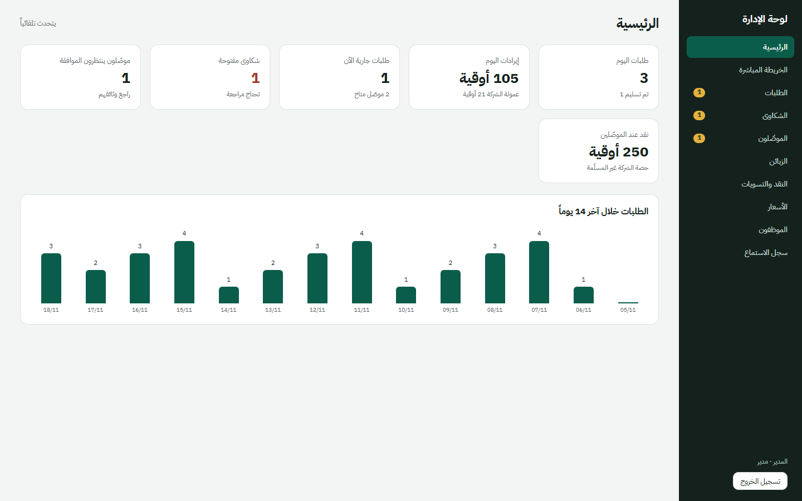 |  |

| الطلبات | تفاصيل الطلب |
| --- | --- |
| 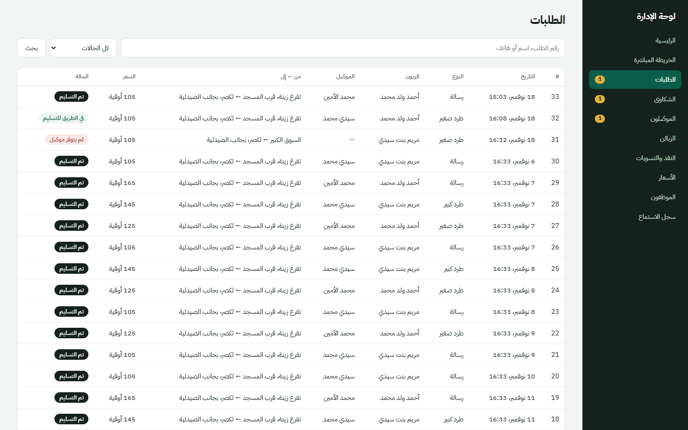 |  |

| ملف الشكوى | الموصّلون |
| --- | --- |
| 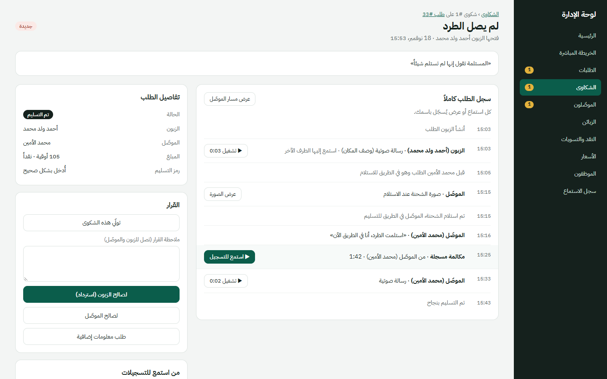 |  |

| النقد والتسويات | الأسعار |
| --- | --- |
| 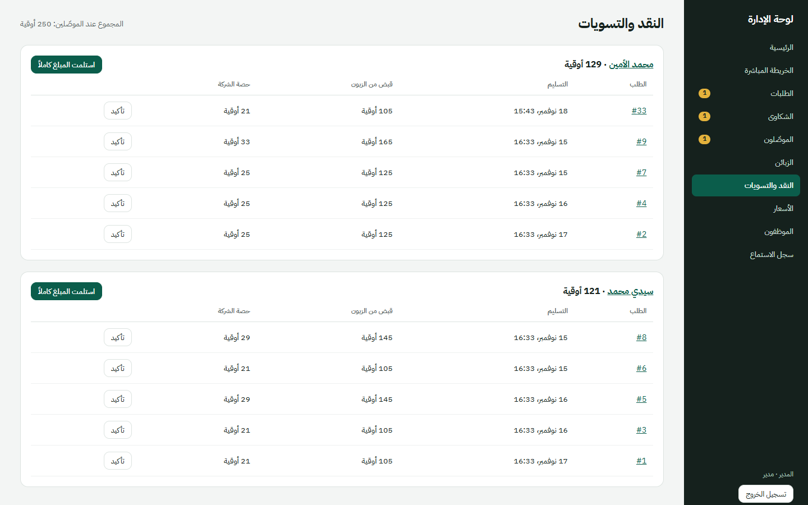 | 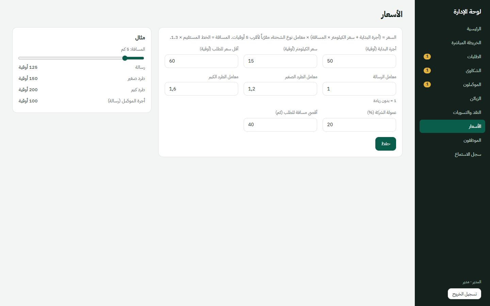 |

| الموظفون | تسجيل الدخول |
| --- | --- |
| 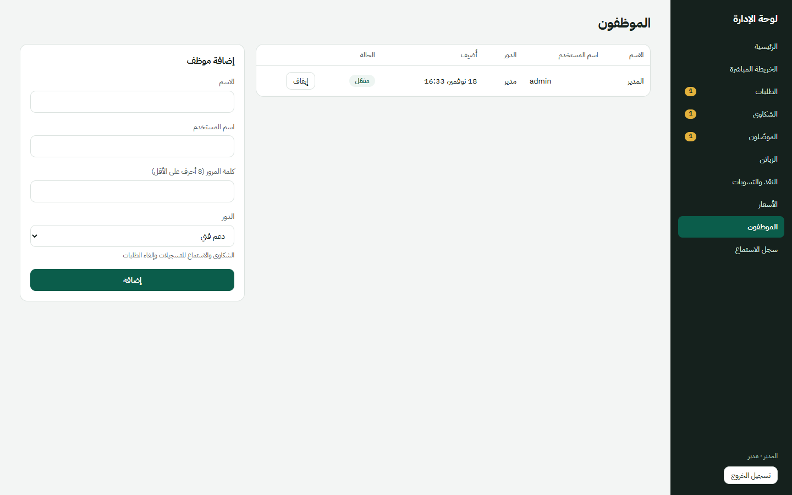 | 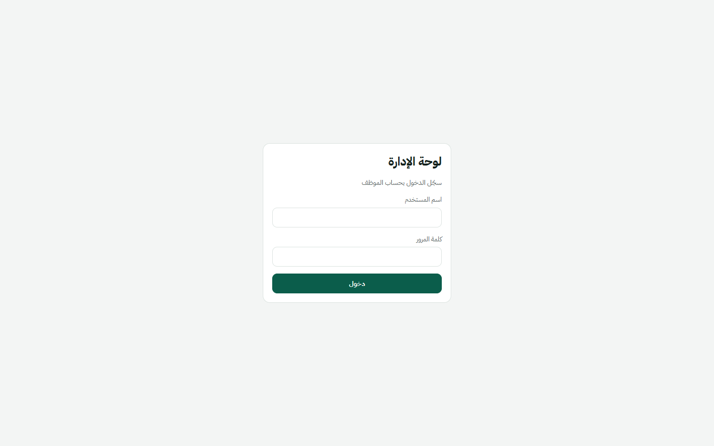 |

### تطبيق الزبون

| الدخول | طلب جديد | التتبع المباشر | المحادثة | طلباتي |
| --- | --- | --- | --- | --- |
|  | 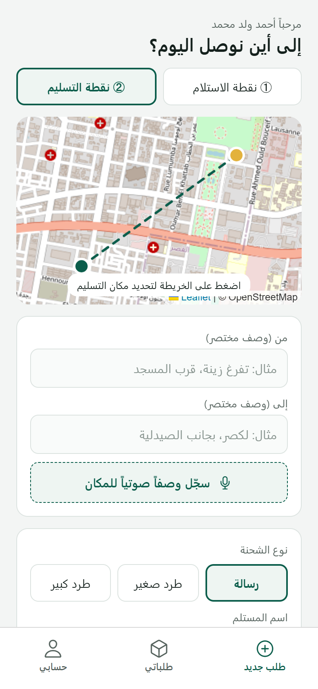 | 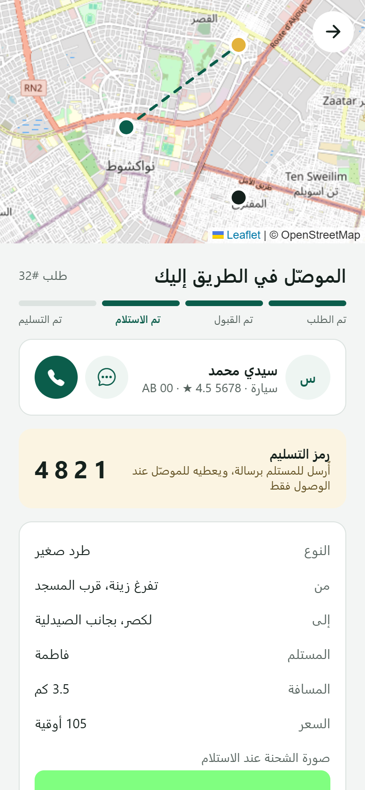 | 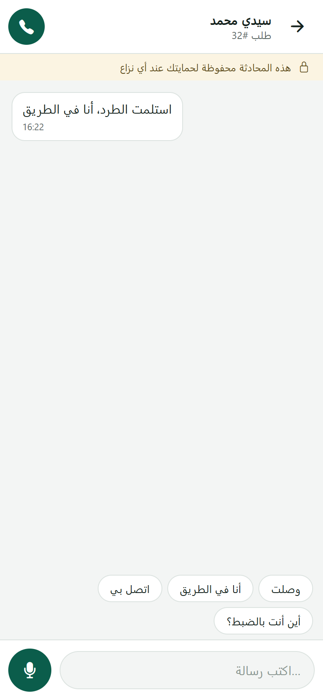 | 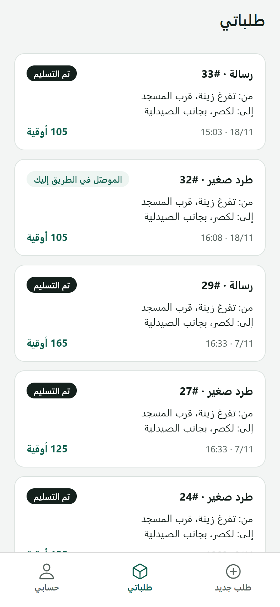 |

### تطبيق الموصّل

| العمل | توصيلاتي | الأرباح |
| --- | --- | --- |
|  | 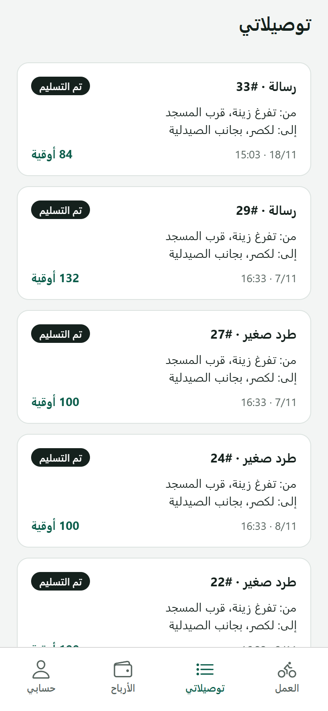 |  |

---

## التشغيل في VS Code

### 1. ما تحتاجه مرة واحدة

- **Node.js 20 أو أحدث** من [nodejs.org](https://nodejs.org) (اختر LTS).
- **VS Code**.
- على هاتفك: تطبيق **Expo Go** من متجر Play أو App Store.
- الكمبيوتر والهاتف على **نفس شبكة الواي فاي**.

افتح المجلد `tawsil` كاملاً في VS Code (File › Open Folder). ستحتاج ثلاث نوافذ طرفية (Terminal › New Terminal، ثم زر `+` لفتح نافذة أخرى).

### 2. الخادم (النافذة الأولى)

```bash
cd server
npm install
copy .env.example .env      # في Mac/Linux: cp .env.example .env
npm run seed                # اختياري: بيانات تجريبية (زبائن، موصّلون، طلبات، شكوى)
npm start
```

يجب أن ترى: `يعمل على http://localhost:4000`.
رمز الدخول (OTP) يظهر في هذه النافذة أثناء التجربة، ويظهر أيضاً داخل التطبيق.

للتأكد أن كل شيء سليم: `npm test` (يشغّل دورة طلب كاملة تلقائياً، 16 اختباراً).

### 3. لوحة الإدارة (النافذة الثانية)

```bash
cd admin
npm install
copy .env.example .env.local
npm run dev
```

افتح [http://localhost:3000](http://localhost:3000) وادخل بـ `admin` / `admin123` (غيّرها في `server/.env` قبل النشر).

### 4. تطبيق الهاتف (النافذة الثالثة)

1. اعرف عنوان IP لجهازك: في Windows افتح cmd واكتب `ipconfig`، وابحث عن **IPv4 Address** (مثل `192.168.1.15`).
2. ثم:

```bash
cd mobile
npm install
copy .env.example .env
```

3. افتح `mobile/.env` وضع عنوانك: `EXPO_PUBLIC_API_URL=http://192.168.1.15:4000`
4. شغّل:

```bash
npx expo start
```

5. امسح رمز QR بتطبيق Expo Go (أندرويد) أو بالكاميرا (آيفون).

**للتجربة كاملة** استعمل هاتفين: سجّل في الأول كزبون وفي الثاني كموصّل، ثم من لوحة الإدارة › الموصّلون › اقبل الموصّل. أو استعمل البيانات التجريبية: زبون `22334455` وموصّل `36112233`.

> إذا لم يتصل الهاتف بالخادم: تأكد أن جدار الحماية في Windows يسمح لـ Node.js على الشبكات الخاصة، وأن الهاتف على نفس الواي فاي.

---

## ما يعمل في Expo Go وما يحتاج نسخة مبنية

| الميزة | Expo Go | نسخة مبنية (development build أو APK) |
| --- | --- | --- |
| الطلبات، الخريطة، التتبع، المحادثة، الرسائل الصوتية، الصور، الشكاوى | نعم | نعم |
| **المكالمات المسجلة (ميزة 2)** | لا: يظهر للمستخدم اقتراح إرسال رسالة صوتية | نعم، بعد إضافة مفاتيح Agora |
| الإشعارات والتطبيق مغلق | لا (أندرويد) | نعم، بعد ربط المشروع بـ EAS |
| الواجهة من اليمين لليسار | تُفرض عند أول تشغيل (يعيد التطبيق تحميل نفسه مرة) | مفروضة من الإعدادات |

### تفعيل المكالمات المسجلة

1. أنشئ حساباً في [Agora](https://console.agora.io) ومشروعاً بشهادة (App Certificate).
2. فعّل **Cloud Recording** في المشروع، وأنشئ مفاتيح REST (Customer ID / Secret).
3. أنشئ حاوية تخزين متوافقة مع S3 لحفظ التسجيلات، وضع فيها قاعدة حذف تلقائي بعد 60 يوماً.
4. املأ قسم Agora في `server/.env` وأعد تشغيل الخادم.
5. ابنِ نسخة تطوير من التطبيق:

```bash
cd mobile
npx eas-cli@latest login
npx eas-cli@latest init
npx eas-cli@latest build --profile development --platform android
```

ثبّت ملف APK الناتج على الهاتف، ثم شغّل `npx expo start --dev-client`.

> راجع أسعار Agora الحالية قبل الإطلاق: تُحسب المكالمات والتسجيل بالدقيقة.

### قبل النشر الفعلي

- [ ] غيّر `JWT_SECRET` وكلمة مرور المدير في `server/.env`، واجعل `NODE_ENV=production`.
- [ ] اربط مزود رسائل SMS يعمل في موريتانيا في `server/src/sms.js` (في وضع الإنتاج لن يعمل الدخول بدونه).
- [ ] ضع مفتاح Google Maps في `mobile/app.json` (`android.config.googleMaps.apiKey`) — مطلوب للخرائط في النسخة المبنية على أندرويد.
- [ ] انشر الخادم على خادم دائم (VPS) مع HTTPS، واضبط `EXPO_PUBLIC_API_URL` و `NEXT_PUBLIC_API_URL` على عنوانه.
- [ ] خذ نسخة احتياطية دورية من `server/data/tawsil.db` ومجلد `server/uploads`.
- [ ] راجع شروط الاستخدام وسياسة الخصوصية مع محامٍ محلي (قانون حماية المعطيات الشخصية رقم 2017-020)، خاصة تسجيل المحادثات.
- [ ] تتبع موقع الموصّل يعمل والتطبيق مفتوح؛ للتتبع في الخلفية أضف `expo-task-manager` وصلاحية الموقع في الخلفية.

---

## تعديل الأسعار

من لوحة الإدارة › الأسعار. المعادلة:
السعر = (أجرة البداية + سعر الكيلومتر × المسافة) × معامل نوع الشحنة، مقرّباً لأقرب 5 أوقيات، ولا يقل عن الحد الأدنى. المسافة = الخط المستقيم × 1.3. القيم الافتراضية أمثلة فقط، ضع أسعارك.

## بنية الكود

```
server/src/
  index.js            تشغيل الخادم و Socket.io
  db.js               جداول قاعدة البيانات والإعدادات الافتراضية
  orders-service.js   توزيع الطلبات على أقرب موصّل
  routes/             auth, orders, messages, calls, courier, admin
  agora.js            رموز المكالمات والتسجيل السحابي
  retention.js        الحذف التلقائي بعد مدة الحفظ
  sms.js / push.js    الرسائل النصية والإشعارات
admin/src/app/(dash)/  صفحات لوحة الإدارة
mobile/src/app/        شاشات التطبيق (customer/ للزبون، courier/ للموصّل)
mobile/src/components/ المكونات: الصوت، الخريطة، المكالمات
```
